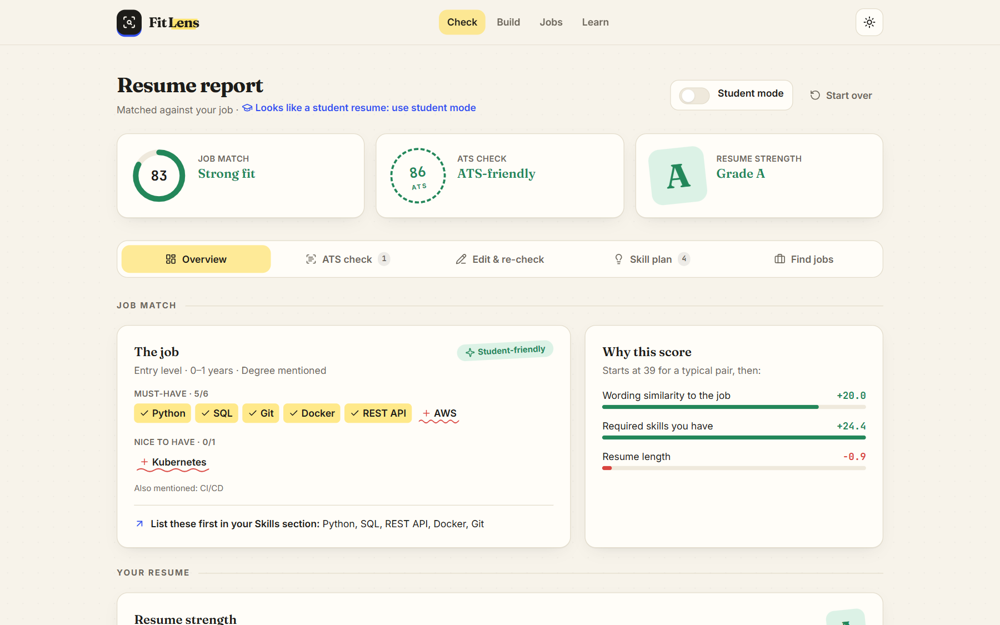
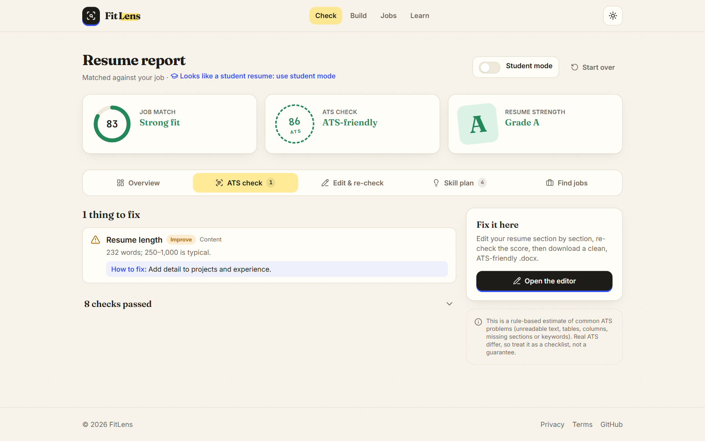
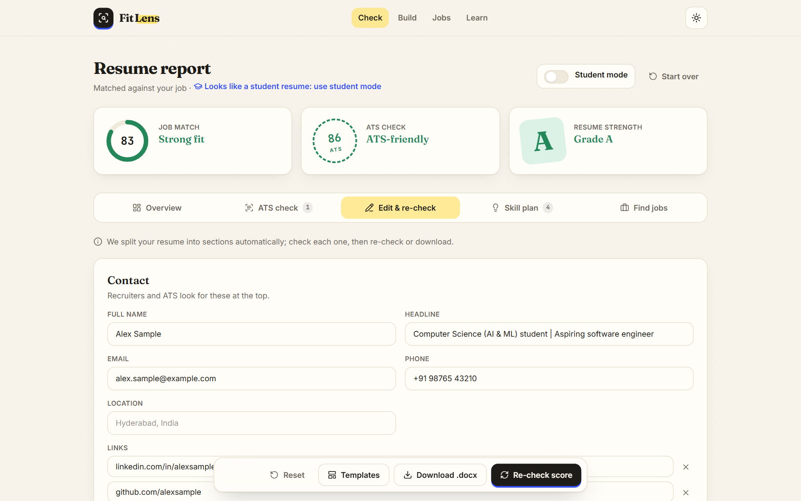
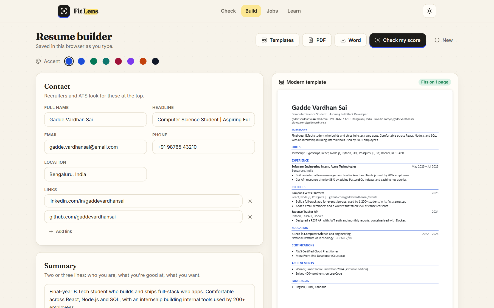
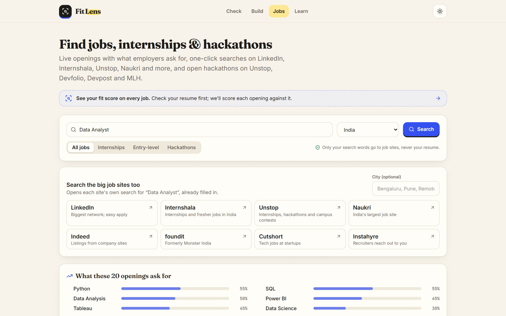
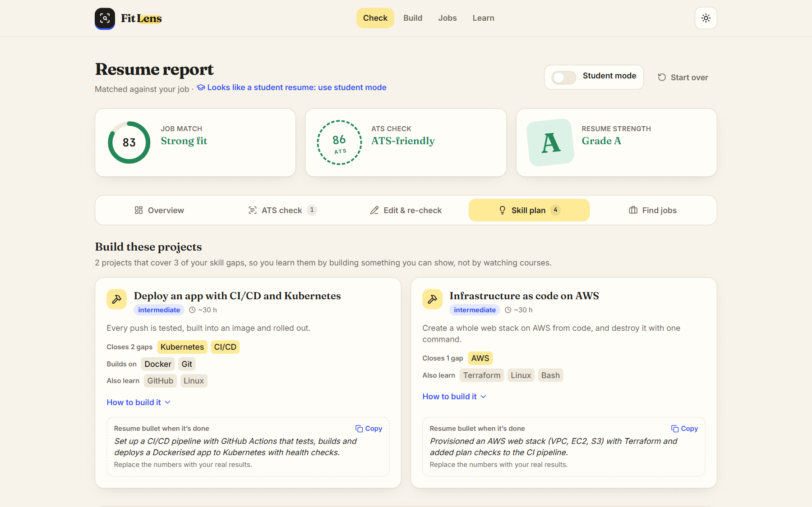
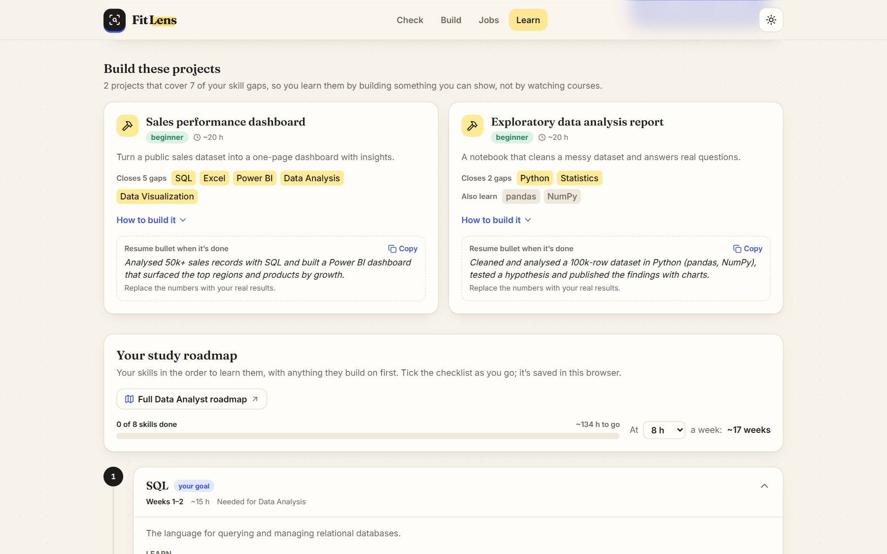
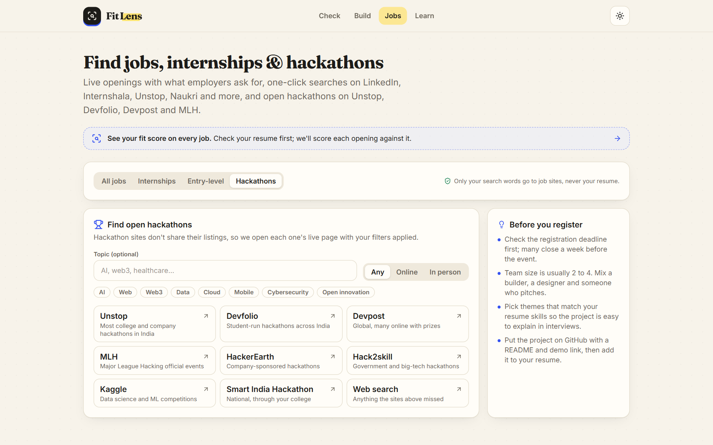
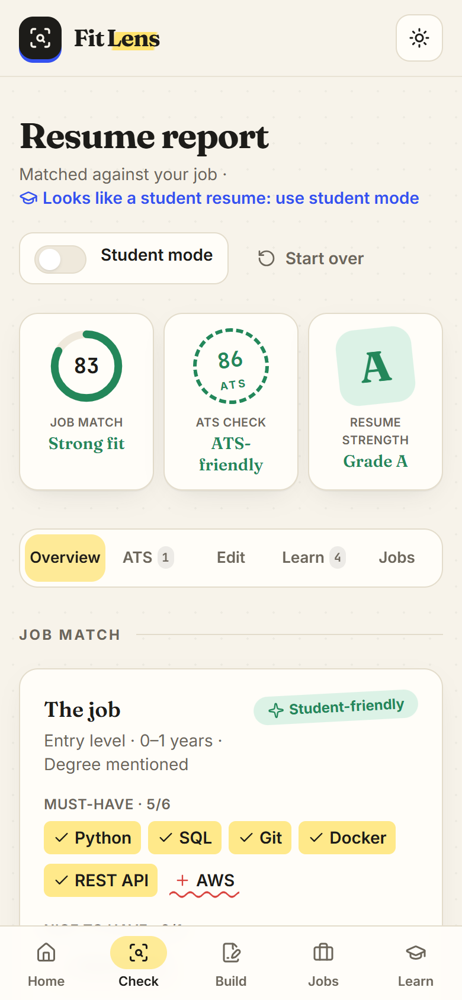
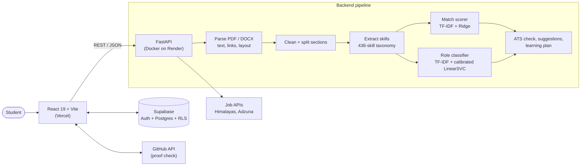

<div align="center">


# FitLens — AI Resume Analyzer

**Scores a resume against any job with machine learning, explains the score, and turns every gap into a next step:<br/>fix the resume, build a better one, find matching jobs and hackathons, and learn the missing skills.**

[](https://resumefitlens.vercel.app)
[](https://resumefitlens.vercel.app/check?demo=high)

[](https://github.com/Vardhansaigadde/AI-RESUME-ANALYZER/actions/workflows/ci.yml)




</div>

## Why FitLens

Students apply to dozens of jobs with one generic resume, often in a layout that applicant tracking
systems (ATS) can't read, and without knowing which skills they're missing. Existing checkers are paid,
send the resume to third-party AI services, or return a single number with no explanation.

FitLens is a free, full-stack web app that answers three questions — **How well do I fit this job? Why?
What do I do next?** — using models I trained and evaluated myself, without sending resumes to any AI
provider.

## Highlights

- **Two ML models, trained and validated without leakage.** A Ridge regression predicts the 0–100 match
  score (R² 0.38, RMSE 17.7 on *unseen jobs* with GroupKFold), and a calibrated Linear SVM predicts the job
  category (**73% top-1 / 92% top-3** across 24 categories on 497 held-out resumes). Each beat two other
  algorithms on the same data.
- **Explainable by design.** Every score is broken into the contribution of each factor ("Why this score"),
  and low-confidence predictions are flagged honestly.
- **Built for real resumes.** Parses PDF and Word files, including hidden GitHub/LinkedIn hyperlinks, Word
  bullet styles and two-column layouts, then runs an ATS-friendliness check with a fix for every problem.
- **End-to-end product.** Resume builder with 12 ATS-safe templates (PDF + Word), live jobs scored against
  the resume, hackathon finder, week-by-week learning roadmaps, an application tracker and accounts.
- **Production quality.** 253 automated tests and linting on every pull request (GitHub Actions), a
  Dockerised API with rate limiting and file-signature checks, and row-level security in PostgreSQL.
- **Privacy first.** Resumes are processed in memory and never stored or sent to an AI service.

## Features

<table>
  <tr>
    <td width="50%"><br/><b>ATS check</b> — layout, sections, contact details, bullet quality and keywords, each with a fix.</td>
    <td width="50%"><br/><b>Edit &amp; re-check</b> — editable sections, a live bullet-point coach, instant re-scoring and Word export.</td>
  </tr>
  <tr>
    <td><br/><b>Resume builder</b> — 12 ATS-safe templates, accent colours, live preview, PDF and Word download.</td>
    <td><br/><b>Jobs &amp; internships</b> — live openings with a fit score each, what employers ask for, one-click searches on 8 job sites.</td>
  </tr>
  <tr>
    <td><br/><b>Skill plan</b> — portfolio projects that close several gaps at once, with a ready-to-paste resume bullet.</td>
    <td><br/><b>Learning roadmap</b> — skills in prerequisite order, free resources, checklists and a weekly schedule.</td>
  </tr>
  <tr>
    <td><br/><b>Hackathons</b> — live listings on Unstop, Devfolio, Devpost, MLH and more, filtered by topic and mode.</td>
    <td align="center"><br/><b>Responsive</b> — works on phones, with light and dark themes.</td>
  </tr>
</table>

## How it works



### The machine learning

| | Match scorer (regression) | Role classifier (classification) |
| --- | --- | --- |
| **Data** | 2,385 resume–job pairs, 23 job descriptions | 2,484 resumes, 24 categories |
| **Features** | TF-IDF cosine similarity, skill-overlap ratio, resume length | Word + bigram TF-IDF (5,000 terms) |
| **Model** | Ridge regression (robust-scaled, soft-capped to 0–100) | Linear SVM + probability calibration, skill-overlap fallback |
| **Validation** | GroupKFold by job, so test jobs are never seen in training | Stratified 80/20 split, title line removed to avoid label leakage |
| **Result** | **R² 0.377 · RMSE 17.7 · MAE 14.5** (beat Random Forest and Gradient Boosting) | **73.2% top-1 · 92.2% top-3** (beat Logistic Regression and Naive Bayes) |

Decisions worth calling out:

- **No data leakage.** Columns produced by the labelling model were excluded from the features, the
  regression is validated on jobs it never saw, and the classifier is also tested with the resume title
  removed, because the title often repeats the label.
- **Simple models on purpose.** Ridge was both the most accurate and the only one whose prediction can be
  explained exactly, which is why the app can show "Why this score".
- **Short student resumes.** A skill-overlap fallback lifted correct predictions on 19 short student
  resumes from 12 to 19, at a cost of 1–2 points on long ones.
- **Honest limits.** The match target was produced by an AI model, not recruiters, which caps the R²
  achievable on this data. The full analysis is in the [technical guide](docs/TECHNICAL.md#model-performance).

## Tech stack

| Layer | Technologies |
| --- | --- |
| Machine learning | scikit-learn, pandas, NumPy, joblib |
| Backend | Python 3.14, FastAPI, Pydantic, pdfplumber, python-docx |
| Frontend | React 19, Vite, Tailwind CSS 4, Framer Motion |
| Data and auth | Supabase (PostgreSQL, Google / email sign-in, row-level security) |
| Quality and delivery | pytest (253 tests), ruff, GitHub Actions CI, Docker, Render, Vercel |

## Run it locally

Requires Python 3.14 and Node 20+.

```bash
python -m venv .venv
.venv\Scripts\activate            # macOS/Linux: source .venv/bin/activate
pip install -r requirements-dev.txt
uvicorn app.main:app --reload     # API on http://127.0.0.1:8000
```

```bash
cd frontend
npm install
npm run dev                       # app on http://localhost:5173
```

Run the checks CI runs: `ruff check . && pytest`, and `npm run build` in `frontend/`.
Accounts are optional locally; see the [technical guide](docs/TECHNICAL.md#accounts-supabase) to enable them.

## Project structure

```text
app/            FastAPI app: routers, services (parser, matcher, classifier, ATS checker…), schemas
app/ml/         feature engineering shared by training and serving
app/data/       curated data: skill taxonomy, roles, learning resources, projects, templates
scripts/        data processing, training, evaluation and data-validation scripts
models/         trained models (.joblib)
reports/        model metrics written by the training scripts
frontend/       React app
tests/          pytest suite
supabase/       database schema and row-level security
docs/           technical guide and screenshots
```

## Documentation

- [Technical guide](docs/TECHNICAL.md): every module, the data, model results, API reference, retraining
  and deployment.
- [Frontend notes](frontend/README.md): design system and component structure.

## Author

**Gadde Vardhan Sai** — B.Tech, Computer Science and Engineering (AI & ML), Aditya University
· [GitHub](https://github.com/Vardhansaigadde)

Built as an academic project with R. Naveen, D. Pardhu and D. Tilak, guided by Mr. G. Siva Shankar.
