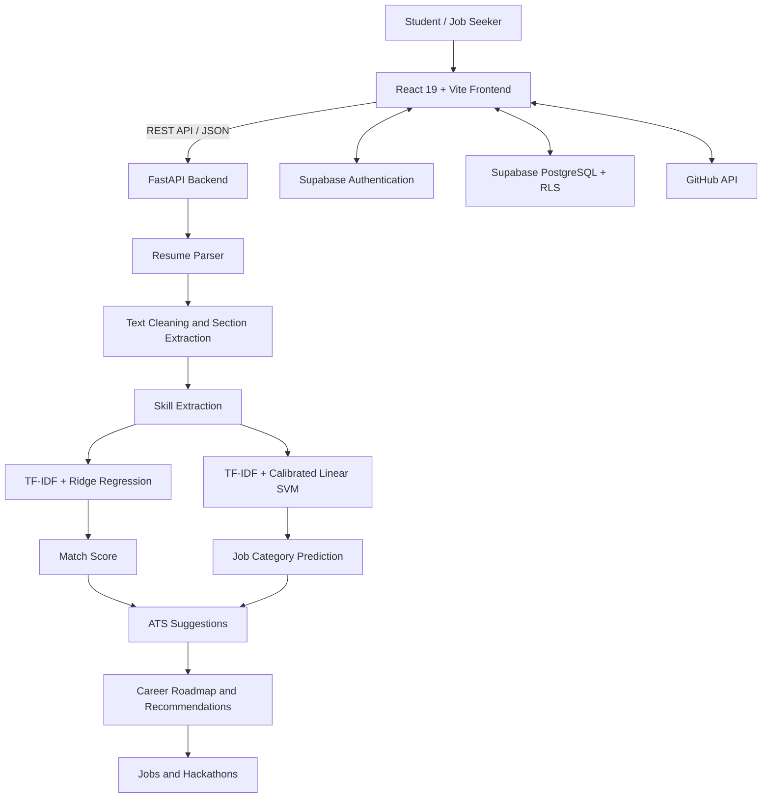

 
<div align="center">


# FitLens — AI Resume Analyzer

**Your resume. Your target job. Your next career move.**

Scores a resume against any job using machine learning, explains the score, and turns every gap into a next step: improve your resume, build a better one, find matching jobs and hackathons, and learn missing skills.

[](https://ai-resume-analyzer-plus.vercel.app/)
[](https://github.com/Suri-618/AI-Resume-Analyzer)
[](https://ai-resume-analyzer-plus.vercel.app/check?demo=high)


</div>

---

## 📌 Overview

Students and job seekers often apply for jobs without knowing whether their resumes match the job requirements. They struggle with ATS compatibility, missing skills, and identifying the right career path.

**FitLens** is a full-stack AI-powered resume analysis and career development platform that helps answer three important questions:

1. How well does my resume match this job?
2. Why did I receive this score?
3. What should I do next to improve my career readiness?

FitLens combines machine learning, resume parsing, ATS analysis, career recommendations, and job discovery in one platform.

The project uses trained machine learning models for resume scoring and job-role classification. Resume analysis is performed through the application's backend rather than sending uploaded resumes to an external generative-AI provider.

## ✨ Key Features

### 1. AI Resume Analysis
- Upload PDF and DOCX resumes.
- Extract resume text, skills, and experience.
- Compare resumes against job descriptions.
- Generate a match score from 0–100.
- Identify strengths, missing skills, and improvement areas.
- Classify resumes into suitable job categories.
- Show confidence information for predictions.

### 2. ATS Resume Checker
- Check resume structure and formatting.
- Identify missing keywords.
- Detect common ATS compatibility issues.
- Receive suggestions to improve resume quality.
- Edit and recheck your resume.

### 3. AI Resume Builder
- Create professional resumes using structured information.
- Choose from 15 ATS-friendly templates.
- Export resumes in PDF and Word formats.
- Generate content using user-provided details.
- Avoid inventing qualifications or experience.

### 4. Career Development
- Identify skill gaps based on target roles.
- Generate personalized learning roadmaps.
- Explore career domains:
  - Web Development
  - Artificial Intelligence and Machine Learning
  - Cloud Computing
  - Cybersecurity
  - Data Science

### 5. Job and Hackathon Discovery
- Explore matching job opportunities.
- Discover relevant hackathons.
- Find opportunities based on skills and interests.
- Track job applications.

### 6. User Accounts and Portfolio
- Google Sign-In and email authentication.
- Protected user pages.
- Personalized resume analysis history.
- Public certificate and portfolio features.
- Supabase authentication and PostgreSQL database with Row Level Security.

### 7. Quality and Security
- 281 automated tests.
- GitHub Actions CI.
- Docker-based API deployment.
- API rate limiting.
- File validation and signature checks.
- Database access protected through RLS policies.

---

## 🖼️ Screenshots

| Feature | Screenshot |
|---|---|
| Resume Analysis | `docs/screenshots/report-overview.png` |
| ATS Analysis | `docs/screenshots/report-ats.png` |
| Resume Editing | `docs/screenshots/report-edit.png` |
| Resume Builder | `docs/screenshots/builder.png` |
| Job Discovery | `docs/screenshots/jobs.png` |
| Skill Gap Analysis | `docs/screenshots/report-skill-plan.png` |
| Learning Roadmap | `docs/screenshots/learn.png` |
| Hackathon Discovery | `docs/screenshots/hackathons.png` |
| Mobile Interface | `docs/screenshots/mobile-report.png` |

To display a screenshot in GitHub Markdown, use:

```markdown

```

---

## 🧠 Machine Learning Models

FitLens uses two machine learning models to analyze resumes and predict career suitability.

### 1. Resume–Job Match Scorer

| Attribute | Details |
|---|---|
| Model | Ridge Regression |
| Dataset | 2,385 resume-job pairs |
| Job descriptions | 23 |
| Features | TF-IDF cosine similarity, skill overlap, resume length |
| Output | Match score from 0–100 |
| Evaluation | GroupKFold by job |
| R² Score | 0.377 |
| RMSE | 17.7 |
| MAE | 14.5 |

**How it works:**

1. Extract text from the uploaded resume.
2. Extract important skills and keywords.
3. Process the target job description.
4. Calculate text similarity and skill overlap.
5. Pass the extracted features to the trained Ridge Regression model.
6. Generate a match score.

### 2. Job Role Classifier

| Attribute | Details |
|---|---|
| Model | Calibrated Linear SVM |
| Dataset | 2,484 resumes |
| Categories | 24 job categories |
| Features | Word and bigram TF-IDF |
| Vocabulary | 5,000 terms |
| Top-1 Accuracy | 73.2% |
| Top-3 Accuracy | 92.2% |
| Evaluation | Stratified 80/20 split |

**How it works:**

1. Extract resume text.
2. Convert text into TF-IDF features.
3. Predict the most suitable job category.
4. Return the top matching career categories.
5. Use skill-overlap fallback logic when required.

### Model Evaluation and Limitations

- GroupKFold evaluation helps prevent job-description leakage in match scoring.
- The role classifier removes the resume title line to reduce title-based leakage.
- Ridge Regression was selected for its explainability and performance.
- Short resumes receive additional fallback handling.
- Predicted match scores are model estimates, not guarantees of recruiter decisions.
- Model performance and limitations are documented in the technical guide.

For detailed information, see [`docs/TECHNICAL.md`](docs/TECHNICAL.md).

---

## 🏗️ System Architecture



### Deployment Architecture

| Component | Technology | Hosting |
|---|---|---|
| Frontend | React + Vite | Vercel |
| Backend API | FastAPI + Docker | Render |
| Authentication | Supabase Auth | Supabase |
| Database | PostgreSQL | Supabase |
| Source Code | Git and GitHub | GitHub |

**Live application:** https://ai-resume-analyzer-plus.vercel.app/

**Backend API:** https://ai-resume-analyzer-api-9709.onrender.com/

---

## 🛠️ Tech Stack

### Machine Learning
- Python 3.14
- Scikit-learn
- Pandas
- NumPy
- Joblib
- TF-IDF
- Ridge Regression
- Linear SVM

### Backend
- Python
- FastAPI
- Pydantic
- PDFPlumber
- Python-docx
- Docker

### Frontend
- React 19
- Vite
- Tailwind CSS 4
- Framer Motion
- Axios

### Authentication and Database
- Supabase Auth
- Google OAuth
- PostgreSQL
- Row Level Security (RLS)

### Testing and Deployment
- Pytest
- Ruff
- GitHub Actions
- Docker
- Render
- Vercel

---

## 🚀 Getting Started

Follow these instructions to run FitLens locally.

### Prerequisites

Install the following:

- Python 3.14
- Node.js 20 or later
- npm
- Git

### 1. Clone the Repository

```bash
git clone https://github.com/Suri-618/AI-Resume-Analyzer.git

cd AI-Resume-Analyzer
```

### 2. Backend Setup

Create a Python virtual environment:

```powershell
python -m venv .venv
```

Activate it on Windows:

```powershell
.venv\Scripts\activate
```

Install dependencies:

```bash
pip install -r requirements-dev.txt
```

Start the backend:

```bash
uvicorn app.main:app --reload
```

Backend API:

```text
http://127.0.0.1:8000
```

API documentation:

```text
http://127.0.0.1:8000/docs
```

### 3. Frontend Setup

Open another terminal:

```bash
cd frontend
```

Install dependencies:

```bash
npm install
```

Start the development server:

```bash
npm run dev
```

Frontend:

```text
http://localhost:5173
```

### 4. Supabase Authentication Setup

If you want to use account registration, login, and Google Sign-In locally, configure your own Supabase project.

1. Create a project at [Supabase](https://supabase.com/).
2. Open Project Settings and obtain your project URL and publishable/anon key.
3. Enable Google authentication under Authentication → Sign In / Providers.
4. Configure a Google OAuth Web Client in [Google Cloud Console](https://console.cloud.google.com/).
5. Add the Supabase callback URL to the Google OAuth client's authorized redirect URIs.
6. Configure your Supabase authentication Site URL and allowed redirect URLs.
7. Run the database schema from `supabase/schema.sql` in the Supabase SQL Editor.

Create a `.env` file inside the `frontend` directory:

```env
VITE_SUPABASE_URL=YOUR_SUPABASE_PROJECT_URL
VITE_SUPABASE_ANON_KEY=YOUR_SUPABASE_PUBLISHABLE_OR_ANON_KEY
```

**Important:**
- Replace the placeholders with your own project values.
- Never commit service-role keys, OAuth client secrets, or other private credentials.
- Use the correct local and production redirect URLs in your authentication settings.
- Keep environment files out of Git using `.gitignore`.

For additional configuration, refer to the project documentation.

---

## 🧪 Running Tests

### Backend Tests

From the project root:

```bash
ruff check .
pytest
```

### Frontend Build

From the `frontend` directory:

```bash
npm run build
```

The project currently includes 281 automated backend tests.

---

## 📂 Project Structure

```text
AI-Resume-Analyzer/
│
├── app/
│   ├── routers/          # API routes
│   ├── services/         # Resume parsing and analysis
│   ├── schemas/          # Request and response schemas
│   └── ml/               # ML feature engineering
│
├── data/
│   └── ...               # Project datasets
│
├── models/               # Trained ML models
├── reports/              # Model evaluation reports
├── scripts/              # Training and data processing
│
├── frontend/
│   ├── public/
│   ├── src/
│   └── README.md
│
├── supabase/
│   └── schema.sql        # Database schema and policies
│
├── tests/                # Automated tests
├── docs/
│   ├── screenshots/
│   └── TECHNICAL.md
│
├── requirements-dev.txt
├── Dockerfile
└── README.md
```

---

## 📚 Documentation

| Document | Description |
|---|---|
| [`docs/TECHNICAL.md`](docs/TECHNICAL.md) | Technical architecture, ML models, evaluation and performance |
| [`frontend/README.md`](frontend/README.md) | Frontend-specific setup and development |
| [`supabase/schema.sql`](supabase/schema.sql) | Database schema and security policies |

---

## 🔐 Privacy and Security

FitLens is designed with privacy and secure application practices in mind.

- Resume processing is handled by the application backend.
- Uploaded resumes are not sent to an external generative-AI provider for the core ML scoring pipeline.
- Authentication is handled through Supabase Auth.
- Database access is protected using Row Level Security policies.
- API endpoints include validation and rate-limiting protections.
- Sensitive credentials should be stored in environment variables.

Always review the application's deployment configuration and database policies before using it with sensitive personal information.

---

## Author

**Surendra Kumar Battagani (Suri)**

- GitHub: [@Suri-618](https://github.com/Suri-618)
- Repository: [AI-Resume-Analyzer](https://github.com/Suri-618/AI-Resume-Analyzer)
- Live Application: [FitLens](https://ai-resume-analyzer-plus.vercel.app/)

- Built the project with D. Tilak,C.Sai Pavan Teja
---

## ⭐ Support

If you find FitLens useful:

- Give the repository a ⭐ on GitHub.
- Share it with students and job seekers.
- Report bugs or suggest improvements through GitHub Issues.
- Contribute ideas and improvements.

---

<div align="center">

**FitLens — Understand your resume. Improve your skills. Move closer to your dream career.**

Made with ❤️ for students and job seekers.

</div>
